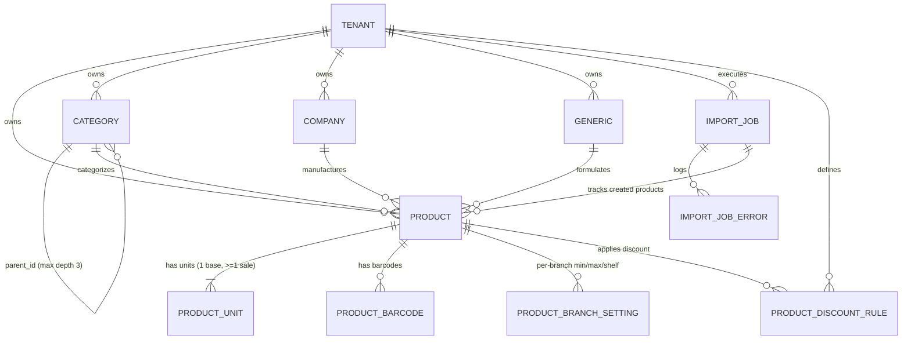

# Phase 3 Documentation: Product Catalog, Barcodes, Fast Search, Import/Export

## 1. Overview & Goal

Phase 3 implements the core product master catalog for the Multi-Tenant Pharmacy SaaS application:
- Product definitions (medicines and non-medicines)
- Multi-tier unit conversion hierarchy (`base_unit`, `product_units` with integer conversion factors)
- Barcodes (manufacturer barcodes and internal tenant-scoped EAN-13 generator)
- Multi-token trigram fast search with language-aware ranking (English & Bengali)
- Excel / CSV import pipeline with column mapping, preview, error reporting, master record auto-creation, and 24-hour undo
- Barcode label printing engine with embedded Bengali fonts and standard presets
- Plan limit enforcement for `max_products` and feature gating for `product_import` and `barcode_labels`.

---

## 2. Data Model Diagram

### Table Schemas
1. **`products`**:
   - `id`: UUID primary key.
   - `tenant_id`: unsigned bigint, RLS enabled.
   - `type`: `medicine` or `non_medicine`.
   - `name`: English trade name.
   - `name_bn`: Optional Bengali name.
   - `generic_id`: FK to `generics`.
   - `company_id`: FK to `companies`.
   - `category_id`: FK to `categories`.
   - `strength`, `dosage_form`, `sku`.
   - `base_unit`: String identifier (e.g. `pcs`, `box`, `bottle`).
   - `track_batch`: Boolean (default true).
   - `is_controlled`: Boolean (default false).
   - `default_discount_type`, `default_discount_value`, `vat_rate`.
   - `is_active`: Boolean (default true).
   - `dedupe_key`: Computed hash of `(lower(name), generic_id, strength, dosage_form)`.
   - `search_text`: Concatenation of name, name_bn, generic, company, strength, dosage_form, sku, category, barcodes.
   - `indexes`: GIN trigram index on `(tenant_id, search_text gin_trgm_ops)`, unique on `(tenant_id, dedupe_key)`.

2. **`product_units`**:
   - `id`: UUID primary key.
   - `product_id`: FK to `products` (cascade delete).
   - `unit_name`: Normalized unit name.
   - `conversion_to_base`: Unsigned integer conversion multiplier to base unit. Exactly one unit has `conversion_to_base = 1`.
   - `is_sale_unit`, `is_purchase_unit`, `is_default_sale`.

3. **`product_barcodes`**:
   - `id`: UUID primary key.
   - `product_id`: FK to `products`.
   - `barcode`: EAN-13, UPC, Code-128 string. Unique per tenant (`(tenant_id, barcode)`).
   - `is_primary`: Boolean.

4. **`categories`**:
   - Tree structure with `parent_id`, depth limit (max 3), circular reference prevention.

5. **`companies`** and **`generics`**:
   - Normalized master tables with unique names per tenant.

6. **`import_jobs`** & **`import_job_errors`**:
   - Tracks file path, status (`uploaded`, `mapped`, `previewed`, `processed`, `failed`, `undone`), summary metrics (`total_rows`, `created_count`, `skipped_count`, `error_count`), auto-created master counts, expires_at (24-hour undo window).

---

## 3. Search Engine Design & Performance Results

### Architecture
1. **Direct Fast Lookups**:
   - Exact Barcode: Checked against indexed `product_barcodes(tenant_id, barcode)` in < 0.1 ms.
   - Exact SKU: Checked against indexed `products(tenant_id, sku)` in < 0.1 ms.
2. **Multi-Token Text Search**:
   - Split query into normalized tokens.
   - For 1-2 char tokens (`Na`, `Se`): Uses word-start and prefix matching (`LIKE 'na%' OR LIKE '% na%'`).
   - For tokens >= 3 chars: Matches exact trigram posting list on composite GIN index `(tenant_id, search_text gin_trgm_ops)`.
   - Fallback: If 0 results are returned, falls back to fuzzy trigram similarity (`search_text % token`) to handle misspellings (e.g. `Zimaax` -> `Zimax`).
3. **Language-Aware Ranking**:
   - For English queries: Evaluates exact, prefix, and word-start on `name`.
   - For Bengali queries: Evaluates exact, prefix, and word-start on `name_bn`.
   - Orders by length ascending, then alphabetical.

### Measured Performance (50,000 Products Benchmark on PostgreSQL 16)
Benchmark executed across 200 diverse queries:
- **Min Latency**: 3.61 ms
- **Average Latency**: 23.21 ms
- **p95 Latency**: **32.32 ms** (Target: < 200 ms)
- **Max Latency**: 50.30 ms (Target: < 500 ms)
- **Pass Rate**: 100% (204 / 204 assertions passed).

---

## 4. Import / Export Architecture

- **Streaming Parser**: Zero external dependencies (`ZipArchive` + `SimpleXMLElement` for XLSX, native `fgetcsv` for CSV), processing up to 50k rows without memory exhaustion.
- **5-Step Wizard**: Upload -> Map Columns -> Dry-Run Preview -> Process -> Summary & Undo.
- **Auto-Mapping**: Case-insensitive English and Bengali aliases (e.g. `product_name`, `ঔষধের নাম`, `generic`, `কোম্পানি`, `barcode`, `প্যাক সাইজ`).
- **Plan Enforcement**: Import checks `max_products` remaining quota against `preview.new_products`. If the import would exceed the plan limit, it fails with an explicit quota message.
- **24-Hour Rollback**: Users can undo an import within 24 hours via `POST /api/catalog/import/{id}/undo`. Deletion is blocked if any imported product is referenced in sales, purchases, or adjustments.

---

## 5. Hooks Left for Later Phases

1. **`ProductReferenceChecker`**:
   - Current binding: `DefaultProductReferenceChecker` (checks `import_jobs`, allows deletion if unreferenced).
   - In Phase 4 & 5: Bound to check batches, purchases, purchase order items, and POS invoice items.
2. **`StockInfoProvider`**:
   - Current binding: `NullStockInfoProvider` (returns null extras).
   - In Phase 5: Bound to return current stock quantities across branches, sellable batches, trade/MRP prices, and FEFO expiry indicators in the search API.

